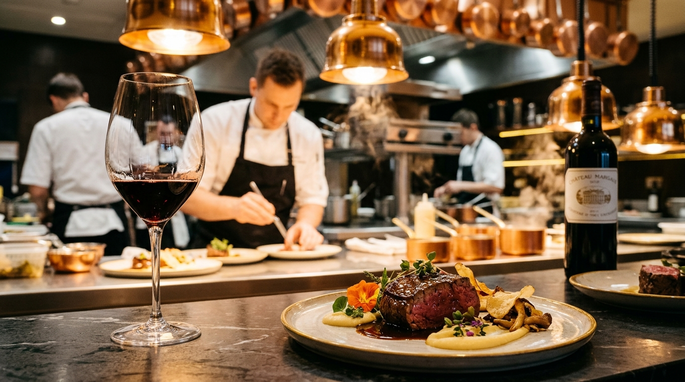

# PassTuner 🍷🍽️
### The Executive Chef & Sommelier Food & Wine Pairing Engine
**Συγγραφέας & Επιστημονική Επιμέλεια:** **[Καρύδας Δημήτριος, Οινολόγος](https://github.com/karidasd)**  
*Επίσημο Εκπαιδευτικό Σύστημα ΣΑΕΚ / ΙΕΚ Μαγειρικής Τέχνης (Chef) & Οινοχοΐας*

---

<p align="center">
  
</p>

<p align="center">
  <a href="https://karidasd.github.io/passtuner"></a>
  <a href="public/docs/BOOK_FOOD_AND_WINE_PAIRING_MASTER_EDITION.pdf"></a>
  <a href="public/docs/PRESENTATION_1_FOOD_AND_WINE_PAIRING_THEORY_AND_INGREDIENTS.pdf"></a>
  <a href="public/docs/PRESENTATION_2_FOOD_AND_WINE_PAIRING_ADVANCED_PRACTICE_AND_WORLD_CUISINES.pdf"></a>
</p>

---

**PassTuner** είναι μια ολοκληρωμένη διαδικτυακή πλατφόρμα Food & Wine Pairing σχεδιασμένη ειδικά για τον επαγγελματία Executive Chef, Sommelier και σπουδαστή Μαγειρικής Τέχνης ΣΑΕΚ / ΙΕΚ κατά τη διάρκεια του service στο πάσο (The Pass).

Βασίζεται στον ομώνυμο εγκυκλοπαιδικό τόμο 164 σελίδων **«ΑΡΜΟΝΙΑ ΣΤΟ ΠΙΑΤΟ ΚΑΙ ΣΤΟ ΠΟΤΗΡΙ»** του Οινολόγου Δημητρίου Καρύδα και παρέχει επιστημονικά τεκμηριωμένη διάγνωση συγκρούσεων, υπολογισμό αναγκών οίνου και βαθμονόμηση του πιάτου σε πραγματικό χρόνο.

---

## 📚 Το Επίσημο Βιβλίο & Ακαδημαϊκό Υλικό (Direct Download Links)

| Εκπαιδευτικό Υλικό | Μορφή & Μέγεθος | Περιγραφή | Σύνδεσμος Λήψης |
| :--- | :--- | :--- | :--- |
| **ΑΡΜΟΝΙΑ ΣΤΟ ΠΙΑΤΟ ΚΑΙ ΣΤΟ ΠΟΤΗΡΙ** *(Master Edition)* | 📕 PDF (164 Σελίδες, 5.98 MB) | Το πλήρες εγχειρίδιο του μαθήματος: 37 κεφάλαια, 27 gourmet συνταγές, 15 σενάρια πάσου και βιοχημεία. | [📥 Άμεση Λήψη Βιβλίου (PDF)](public/docs/BOOK_FOOD_AND_WINE_PAIRING_MASTER_EDITION.pdf) |
| **Διάλεξη 1: Θεωρία & Βασικά Υλικά** | 🖥️ PDF (60 Slides Widescreen, 1.0 MB) | Αρχές γευσιγνωσίας, βιοχημεία 5 γεύσεων, θερμοκρασίες, σάλτσες, τυριά και θαλασσινά. | [📥 Λήψη Παρουσίασης 1 (PDF)](public/docs/PRESENTATION_1_FOOD_AND_WINE_PAIRING_THEORY_AND_INGREDIENTS.pdf) |
| **Διάλεξη 2: Προχωρημένη Πράξη & Διεθνείς Κουζίνες** | 🌍 PDF (60 Slides Widescreen, 0.99 MB) | Κυνήγι, Dry-Aging, Ethnic (Ιαπωνία, Ταϊλάνδη, Μεξικό), Degustation σχεδιασμός & Pass Management. | [📥 Λήψη Παρουσίασης 2 (PDF)](public/docs/PRESENTATION_2_FOOD_AND_WINE_PAIRING_ADVANCED_PRACTICE_AND_WORLD_CUISINES.pdf) |

---

## 🌟 Πλήρης Σουίτα Εργαλείων (Core Features)

### 1. ⚡ The Master Pass Matrix
* **26 Gourmet Δημιουργίες:** Θαλασσινά, Κρεατικά, Pasta, Dry-Aged, Επιδόρπια, Kaiseki.
* **Άμεση Διάγνωση:**
  * **Γευστική Πρόκληση:** (π.χ. ιώδιο, κολλαγόνο, κιναρίνη, καψαϊκίνη).
  * **Οινικός Εχθρός:** Ποιο κρασί απαγορεύεται και γιατί θα καταρρεύσει.
  * **👨‍🍳 Chef's Calibration Note:** Άμεση παρέμβαση στο πάσο (π.χ. προσθήκη ανθού αλατιού, monter au beurre, έλεγχος οξύτητας).
  * **🔬 Χημεία Αρμονίας (Sommelier Science):** Μοριακή/βιοχημική τεκμηρίωση με 1 κλικ.
  * **🏆 Winning Pairing:** Το ιδανικό κρασί (ΠΟΠ/ΠΓΕ).

### 2. 🎛️ Dynamic Pairing Calculator (Υπολογιστής Αρμονίας Πάσου)
* Επιλέξτε οποιονδήποτε συνδυασμό:
  * **Κύρια Πρωτεΐνη** (9 κατηγορίες: Μόσχος, Αρνί, Ψάρια, Οστρακοειδή, Ζυμαρικά, Τυριά, Γλυκά κ.ά.)
  * **Τεχνική Μαγειρέματος** (6 τεχνικές: Σχάρα/Maillard, Braised, Beurre Blanc, Ποσέ, Ωμό, Καπνιστό)
  * **Κυρίαρχη Σάλτσα** (7 προφίλ: Κιτρικό, Κρέμα, Jus Κόκκινου Κρασιού, Σόγια/Umami, Τσίλι, Μέλι κ.ά.)
* **Αποτέλεσμα:** Δυναμικοί μετρητές απαίτησης Τανινών (0-5), Οξύτητας (1-5) και Σώματος, προτεινόμενες ποικιλίες και Chef's Seasoning Tip.

### 3. 📋 Degustation Menu Flow Validator (Έλεγχος Ροής Μενού 5-8 Σταδίων)
* Σχεδιάστε και αναλύστε τη διαδοχή των κρασιών σε ένα μενού γευσιγνωσίας.
* **Αυτόματος Έλεγχος των Χρυσών Κανόνων Διαδοχής:**
  * ❌ *Sweet before Dry Alert:* Προειδοποίηση εάν σερβιριστεί γλυκό κρασί πριν από ξηρό.
  * ❌ *Tannin / Color Inversion:* Εντοπισμός εάν σερβιριστεί βαρύ ερυθρό πριν από λεπτό λευκό.
  * ⚠️ *Severe Body Drop:* Προειδοποίηση για απότομη πτώση έντασης στο στόμα.
  * 🌟 Υπολογισμός Harmony Score (0-100%) και ενσωματωμένα έτοιμα πρότυπα μενού.

### 4. 🇬🇷 Άτλας Ελληνικού Αμπελώνα & Γαστρονομίας (Greek Varieties Master Guide)
* Πλήρης οδηγός για τις **8 εμβληματικές γηγενείς ποικιλίες**:
  * **Ασύρτικο, Ξινόμαυρο, Αγιωργίτικο, Μοσχοφίλερο, Βιδιανό, Ρομπόλα, Μαυροτράγανο, Σαββατιανό**.
* Για κάθε ποικιλία: Οργανοληπτικοί μετρητές (Οξύτητα, Τανίνες, Σώμα, Αλκοόλ), αρώματα, περιγραφή στυλ, **Top 3 Κορυφαίοι Συνδυασμοί** και **Top 3 Οινικοί Εχθροί**.

### 5. 🎓 Sommelier Exam Quiz: Αυτοαξιολόγηση Σπουδαστών ΣΑΕΚ / ΙΕΚ
* **10 Επιστημονικές Ερωτήσεις Πιστοποίησης** βασισμένες απευθείας στην εξεταστέα ύλη του βιβλίου.
* Άμεση βαθμολόγηση, επιστημονική αιτιολόγηση σε κάθε επιλογή και απονομή τίτλου/badge (Master Sommelier, Senior Sommelier, Commis).

### 6. 🚨 Emergency Palate Rescue
* Πρωτόκολλα διαχείρισης κρίσεων στο τραπέζι κατά το service rush (στυπτικότητα, πλαδαρότητα, καύσος καψαϊκίνης, οξείδωση Fe²⁺/στρειδιών).

### 7. 🧬 The Biochemical 5 Tastes Matrix
* Αναλυτικός διαδραστικός πίνακας για το πώς το Αλάτι, η Οξύτητα, το Λίπος, το Umami, η Γλυκύτητα και η Καψαϊκίνη μεταβάλλουν την αντίληψη του κρασιού.

### 8. 📊 Επιστημονικοί Οπτικοί Οδηγοί & Lightbox
* Υψηλής ανάλυσης διαγράμματα (5 Tastes Matrix, Doneness vs Tannins, Temperature Guide 6°C-18°C) με δυνατότητα μεγέθυνσης σε πλήρη οθόνη.

### 9. 🖨️ Εκτυπώσιμος Οδηγός Πάσου A4 (Printable Quick Sheet)
* Με ένα κλικ στο κουμπί **«🖨️ Εκτύπωση Pass Sheet»**, μορφοποιείται αυτόματα μέσω ειδικού print stylesheet ένας συμπυκνωμένος οδηγός 1 σελίδας A4 για πλαστικοποίηση και τοποθέτηση στον τοίχο της κουζίνας.

---

## 🚀 Εγκατάσταση & Τοπική Εκτέλεση (Quick Start)

```bash
# Clone the repository
git clone https://github.com/karidasd/passtuner.git

# Navigate into the project directory
cd passtuner

# Install dependencies
npm install

# Start local development server
npm run dev

# Run automated tests
npm test
```

Η εφαρμογή θα ανοίξει στο `http://localhost:5173`.

---

## 📦 Build για Παραγωγή (Production Build)

```bash
npm run build
```

Τα έτοιμα αρχεία στατικής ιστοσελίδας θα δημιουργηθούν στον φάκελο `dist/` έτοιμα για ανάρτηση σε GitHub Pages, Vercel, Netlify ή οποιοδήποτε web hosting.

---

## 👨‍🏫 Συγγραφέας & Επιστημονική Επιμέλεια

* **Καρύδας Δημήτριος** — *Οινολόγος, Εκπαιδευτής ΣΑΕΚ / ΙΕΚ*
* Τομέας Γαστρονομίας, Μαγειρικής Τέχνης & Οινοχοΐας.
* GitHub: [@karidasd](https://github.com/karidasd)

---

## 📄 Άδεια Χρήσης (License)

Το έργο διατίθεται υπό την άδεια [MIT License](LICENSE).
